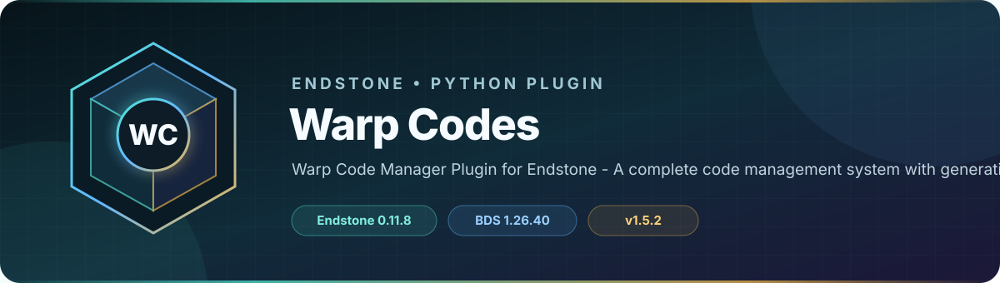

<!-- endstone-professional-header:start -->
<p align="center">
  
</p>

<p align="center">
  <a href="https://github.com/TheNINJALLO/endstone-warp-codes/actions/workflows/wheel-release.yml"></a>
  <a href="https://github.com/TheNINJALLO/endstone-warp-codes/releases/latest"></a>
</p>

<p align="center">
  
  
  
  =3.10" src="https://img.shields.io/badge/Python-%3E=3.10-3776AB?style=flat-square&amp;logo=python&amp;logoColor=white">
</p>

<p align="center">
  <strong>Warp Code Manager Plugin for Endstone - A complete code management system with generation, redemption, and tag management.</strong>
</p>

<p align="center">
  <a href="#what-it-does">What it does</a> &bull;
  <a href="#how-to-use">How to use</a> &bull;
  <a href="#commands-and-permissions">Commands</a> &bull;
  <a href="#install">Install</a> &bull;
  <a href="https://github.com/TheNINJALLO/endstone-warp-codes/releases">Releases</a>
</p>

## Overview

Warp Code Manager Plugin for Endstone - A complete code management system with generation, redemption, and tag management. This release is aligned with Endstone 0.11.9 and Minecraft Bedrock Dedicated Server 1.26.44, and is distributed as a Python wheel for direct installation in an Endstone server.

## What it does

- Generates time-limited warp/access codes, redeems them, and manages the resulting player tags.
- Provides GUI-based administrator management, player history and time-left views, statistics, and webhook support.
- Includes repair and cleanup operations for code and player-tag consistency.

## How to use

1. Run `/codes` (or `/warp` or `/warpcodes`) as an operator and configure a code pool through the management form.
2. Give a generated code to a player through your intended private channel; the player enters it through `/redeem`.
3. Players can check `/timeleft` and `/myhistory`; transfer-capable codes use `/toc <player>`.
4. Use cleanup, name-update, tag-fix, and statistics commands only as an operator after backing up plugin data.

## Commands and permissions

| Command / usage | What it does | Access |
|---|---|---|
| `/codes`<br><sub>Aliases: `/warp`, `/warpcodes`</sub> | Manage warp codes | `warp.admin` |
| `/redeem` | Redeem a warp code | All players |
| `/viewall` | View all players' active codes | `warp.admin` |
| `/stats` | Show warp code statistics | `warp.admin` |
| `/clearunredeemed` | Clear all unredeemed codes | `warp.admin` |
| `/timeleft` | Check your active codes | All players |
| `/toc <player>` | Transfer build tag to another player | All players |
| `/generate` | Generate codes (fallback) | `warp.admin` |
| `/myhistory` | View your code redemption history | All players |
| `/updateplayernames` | Update player names in database | `warp.admin` |
| `/fixtags` | Fix tags for all players (reactivate valid codes) | `warp.admin` |

## Compatibility

| Component | Supported version |
|---|---|
| Endstone | `0.11.9` |
| Endstone API | `0.11` |
| Bedrock Dedicated Server | `1.26.44` |
| Python | `>=3.10` |
| Plugin release | `v1.5.3` |

## Install

Download the wheel from the matching GitHub release:

```bash
gh release download v1.5.3 --repo TheNINJALLO/endstone-warp-codes --pattern "*.whl"
```

Copy the downloaded wheel into the server's `plugins/` directory, remove any older wheel for the same plugin, and restart Endstone.

> [!IMPORTANT]
> Use Endstone `0.11.9` with BDS `1.26.44`. Back up worlds and plugin data before upgrading a production server.

## Configuration and secrets

Runtime databases, logs, local `.env` files, server directories, and root `config.toml` files are excluded from source releases. When an example configuration is provided, copy it locally and keep live tokens, passwords, webhook URLs, and server identifiers out of Git.

## Release automation

Every `v*` tag runs [the wheel release workflow](.github/workflows/wheel-release.yml), builds the package in a clean GitHub runner, stores the wheel as a workflow artifact, and attaches it to the matching GitHub release.
<!-- endstone-professional-header:end -->

---

## Project guide

A comprehensive Warp Code Manager Plugin for Endstone - A complete code management system with generation, redemption, and tag management for Minecraft Bedrock Edition servers.

## Features

- **Code Generation**: Generate single-use and multi-use warp codes with custom durations
- **Code Redemption**: Players can redeem codes to receive temporary tags
- **Time Stacking**: Redeeming codes of the same type extends existing time
- **Tag Management**: Automatic tag application and removal based on code expiration
- **Build Tag Transfer**: Transfer build tags between players
- **Statistics**: View comprehensive system and player statistics
- **Redemption History**: Players can view their code redemption history

## Commands

### Admin Commands (requires warp.admin permission)
- `/codes` - Open code management menu
- `/warp` - Alias for /codes
- `/warpcodes` - Alias for /codes
- `/viewall` - View all players' active codes
- `/stats` - Show system statistics
- `/clearunredeemed` - Clear unredeemed codes
- `/generate` - Generate codes
- `/updateplayernames` - Update player names in database
- `/fixtags` - Fix tags for all players

### Player Commands
- `/redeem` - Redeem a warp code
- `/timeleft` - Check your active codes
- `/toc <player>` - Transfer build tag to another player
- `/myhistory` - View your code redemption history

## Installation

1. Build the plugin wheel: `pip wheel . --no-deps -w dist`
2. Copy the `.whl` file to your Endstone plugins folder
3. Restart the server

## Version

1.3.3
